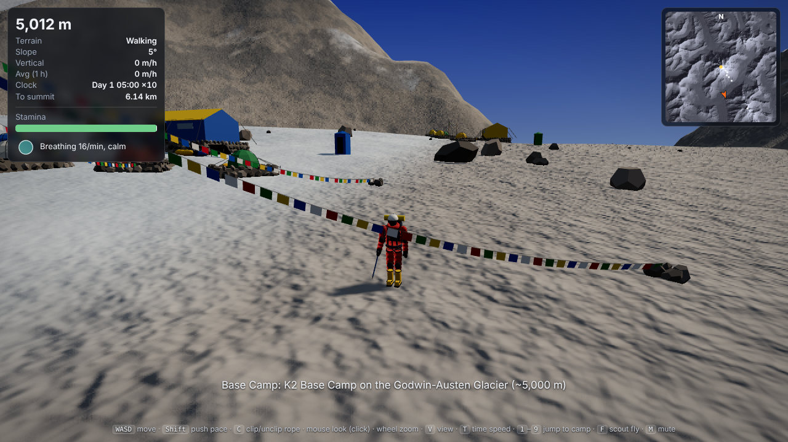
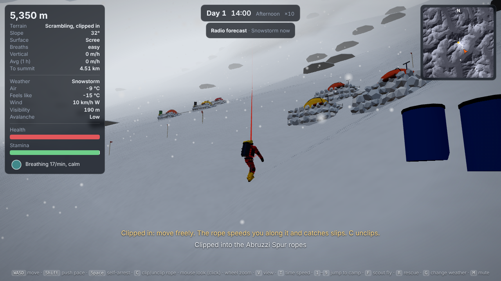
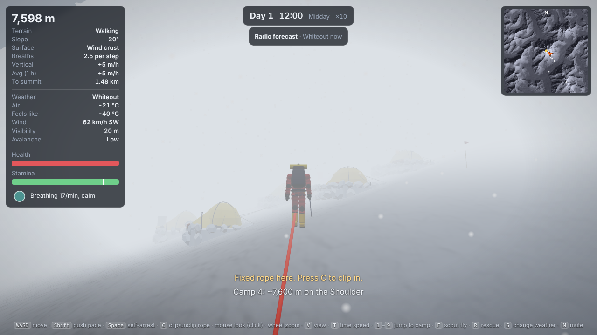
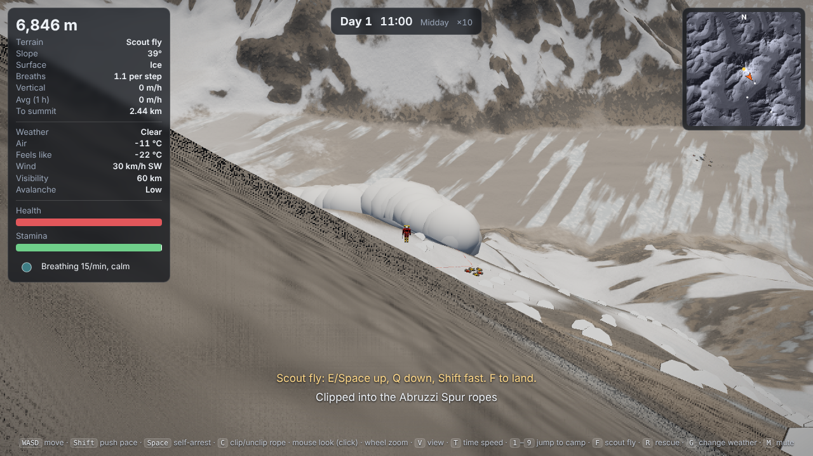
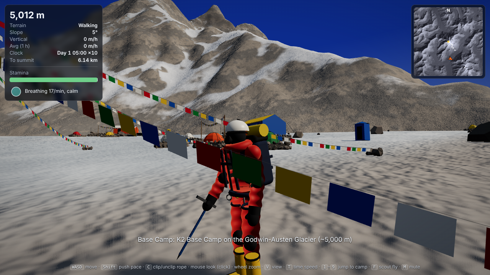

# K2 Climbing

A 3D open-world climbing survival game on a real-scale K2, built with
[three.js](https://threejs.org) and [Vite](https://vitejs.dev). The terrain is the
real mountain from the Copernicus GLO-30 elevation model (20 × 20 km around the
summit, 31.25 m grid).

This first step is about how it feels to move up the mountain.



## Run it

You need [Node.js](https://nodejs.org) 18 or newer.

```sh
npm install
npm run dev
```

That opens the game at http://localhost:5173. Edits to the code reload the page
as you save.

| Command | What it does |
| --- | --- |
| `npm run dev` | Runs the game locally with live reload |
| `npm test` | Runs the pace, stamina and movement tests |
| `npm run build` | Builds a static site into `dist/` |
| `npm run preview` | Serves the `dist/` build locally |

Every merge to `main` also tests and publishes the game to GitHub Pages
(`.github/workflows/web.yml`). Turn this on once in the repo's **Settings → Pages →
Build and deployment → Source: GitHub Actions**. The game is then at
https://ruisbasement-code.github.io/k2/.

### Controls

| Key | Action |
| --- | --- |
| W A S D | Move (relative to the camera) |
| Shift | Push the pace: faster, but stamina drains much quicker (and it helps little up high) |
| C | Clip into / unclip from a fixed rope (within 5 m) |
| Space (hold) | Self-arrest when you start sliding |
| R | After dying: be rescued to the highest camp you reached |
| Mouse (click to capture), wheel | Look around, zoom |
| V | First / third person |
| T | Time speed: 1×, 5×, 10× (default), 20×, 60× |
| 1 – 9 | Jump to Base Camp, ABC, Camps 1–4, Bottleneck, Summit, Broad Peak |
| F | Scout fly (dev tool; E/Space up, Q down) |
| G | Change the weather (dev tool): clear, cloudy, high winds, fog, snow, storm, whiteout |
| M | Mute breathing and wind |
| Esc | Release the mouse |

## How movement works

**Time.** The mountain clock runs faster than real time (10× by default), so a
realistic pace still gets you somewhere. All the speeds below are in mountain time.

**Slopes.** Fixed ropes are the only aid for now (gear comes later):

- **Walking** below 25°. Speed follows Tobler's hiking function: about 5 km/h on
  the flat at sea level, much slower uphill.
- **Scrambling** from 25° to 35°: slow and tiring. Every step is a separate
  placement and can slip, more likely the steeper it is, the more slippery the
  surface, and when the step is careless (pushing with Shift), turns sharply, or goes
  downhill (most accidents happen on the way down).
- **Above 35° only on a fixed rope.** Unroped, you can't go up it, and if you stand
  on ground steeper than its surface can hold you, you start to slide.
- **Fixed ropes**: press **C** within 5 m of the orange rope. A blue tether runs from
  your harness to a carabiner on the rope, hanging slack and lying on the snow until
  you reach its end or it catches a fall. You are not locked to
  the line: you move freely up to 8 m from it. Moving along the rope gets the jumar's
  speed, the rope gently steers you back toward its line as you drift, it lets you
  climb anything near it, and slips are rarer. If you do slip, the jumar locks and you
  drop (and swing, if you were off to the side) until the rope comes tight; a hard
  jolt hurts. Reach either
  end and you unclip. There are two ropes: the Abruzzi Spur from Advanced Base Camp to
  Camp 4, and the Bottleneck and Traverse from above Camp 4 to about 8,450 m.

**Momentum.** You speed up and slow down over a moment instead of instantly, and a
sharp turn costs the speed you built up. Running downhill (Shift) on ground over
15° can trip you, pitching you head-first.

**Surfaces** grip differently (`surfaces` in `tuning.json`): powder is slow going
but grippy, firm snow holds you to 35°, rock to 37°, scree to 33°, glacier ice to 30°,
and hard ice only to 27°. Ice slides the furthest and is the hardest to stop on.

- **Snow types.** Above 6,800 m open snow is a hard, slippery wind crust. Below
  6,400 m the afternoon sun (roughly 10:30 to 17:30) turns snow to slow, wet slush
  that won't hold steep angles.
- **Sinking and trails.** You sink knee-deep into powder, which slows you and costs
  effort. Every step leaves a footprint that packs the snow, so going back along your
  own trail is faster and you sink less.
- **Loose rock.** Some rock and much of the scree is loose. A step on it can crumble
  the hold, send stones down the slope and make you slip.

**Ledges.** The 31 m elevation grid smooths away the small steps and terraces of a
real face, so steep ground is dotted with small ledges (the level shelves you can see
near you). You can stand on one where the slope around it is too steep, and a slide
across one loses a lot of speed.

**Rock and ice fall** is built (`rockfall_enabled` in `tuning.json`) but switched off
for now: loose holds still crumble, but send no rocks down.

**Breathing pace.** Up high every step uphill takes several breaths: under one at
Base Camp, about one at 6,500 m, 3–4 at 8,000 m and 7 near the summit (the HUD shows
it). Pushing the pace skips breaths; keep it up and you have to stop and gasp until
your breathing catches up.

**Falls.** A slip or too-steep ground starts a slide. You pick up speed down the
fall line, slowed by the surface's friction. Hold **Space** straight away to
self-arrest: it works while you are still slow (under 8 m/s) and within about 2
seconds, much better on snow than ice. A runaway slide that slows down again (on a
ledge or a gentler run-out) can still be arrested. How you landed matters: slipping while facing
into the slope puts you on your front, feet first, the best position; facing out
puts you on your back. Holding Space rolls you onto your front (half a second) and
then swings your feet round downhill (another second), so a head-first slide on your
back is the hardest to stop. Too fast, too late, or a hard hit, and you
tumble (a ragdoll) only when you leave the ground, hit hard or go over ground steeper
than 50°; back on gentler ground a tumble flattens out into a slide again. Speeds
are physical: air drag (thinner up high), snow you plough through, and energy lost
in every bounce of a tumble keep a long fall to about 25–30 m/s.
Damage comes from how hard you hit the ground and from scraping over rock at speed,
not from how far you fell, so a long slide on snow can hurt less than a short drop
onto rock. Health heals slowly at rest and faster in a camp. At 0 you die, and **R**
gets you rescued to the highest camp you reached, hours later and still hurt.

**Day counter.** The top of the screen shows the expedition day, time and part of the
day. The sun rises around 05:30, passes high in the south and sets around 19:00, and
nights are dark. You start at 06:00 on day 1.

**Altitude.** Pace is scaled by an altitude curve for an acclimatized climber without
bottled oxygen. Steady pace while moving (`npm test` prints this table):

| Altitude | Walk 25° | Steep 40° | Rope 45° up | Rope 45° down |
| --- | --- | --- | --- | --- |
| 5,000 m | 436 m/h | 363 m/h | 412 m/h | 740 m/h |
| 6,000 m | 377 | 314 | 356 | 688 |
| 7,000 m | 276 | 229 | 260 | 588 |
| 8,000 m | 156 | 130 | 147 | 443 |
| 8,400 m | 104 | 87 | 99 | 362 |
| 8,600 m | 84 | 70 | 79 | 324 |

With rests, a steady climber takes about 13 hours of climbing from ABC to Camp 4,
and about 10 hours from 7,900 m to the top of the Traverse, close to a real summit morning.

**Stamina and breathing.**

- Stamina drains when you work harder than you can sustain: steady climbing drains
  it, and pushing drains it about 3× faster. It recovers when you rest or walk easily.
- Thin air drains it faster and refills it slower. Above 7,000 m it cannot refill
  completely: the white tick on the stamina bar is the most you can recover at your
  altitude (about 65% near the summit).
- Below 30% you slow down. At 0 you stop, gasping, until you have recovered a little.
- Your breathing rate follows effort and altitude. You see it in the pulsing ring,
  the edge of your vision darkens as you run out, and you hear it (M mutes it).

On steep ground the view sways a little with your breathing, and a jolt (a slip, a
crumbling hold, a rock) shakes it.

The HUD shows your altitude, slope, terrain mode, surface (and how deep you sink), breaths per step, vertical speed now and over the
last mountain hour, the mountain clock, and distance to the summit.

All of these numbers live in [`src/data/tuning.json`](src/data/tuning.json), so
tuning is editing numbers, not code.

## Weather



The weather comes in spells: **clear**, **cloudy**, **high winds**, **fog**, **snowing**,
**snowstorm** and **whiteout**. Each lasts from under an hour (a whiteout) to more than a day
(a long clear window or a big storm), and the next one is picked from what usually follows,
with snow and storms much more likely to build in the afternoon. Most spells fade in over
half an hour or more; a whiteout closes in within minutes. The weather is a seeded timeline,
so the same `?seed=` gives the same season.

- **Temperature** swings from about −7 °C before dawn to +5 °C mid-afternoon at Base Camp
  and drops 6.5 °C per kilometre of height: about −25 °C or colder on the summit at night.
  Clear nights are colder, cloud keeps the warmth in, storms are 8 °C colder.
- **Wind** is light low down and rises toward the jet stream near the summit. Ridges and
  crests catch all of it, hollows and couloirs are sheltered, and it gusts every few
  seconds. It mostly blows from the west. Over about 40 km/h it pushes you downwind (a
  third as much on the rope), walking into it slows you, and gusts over about 85 km/h can
  throw you off steep unroped ground. **Feels like** is the wind chill.
- **Visibility** follows the weather: 60 km on a clear day, under 200 m in a storm, tens of
  metres in fog and about 10 m in a whiteout, where sky and snow merge into one grey.
  On cloudy days a cloud band sits between about 6,300 and 7,600 m, so you climb up into it
  and out above it. Fog and cloud drift through, so visibility comes and goes over minutes,
  and strong wind lifts spindrift off the ridges. Falling and blowing snow streams past with
  the wind, and you hear the wind rise and fall with the gusts.
- **Avalanches.** Snowfall builds up fresh snow, the wind drifts it into slabs, and both
  settle over a few days, faster when it's warm. The HUD shows the danger on the usual
  scale (Low, Moderate, Considerable, High, Extreme). Slabs break on snow slopes between
  28° and 50°: natural slides start somewhere above you, and crossing a loaded slope can
  break one under your feet. The debris pours down the fall line under a powder cloud.
  If it reaches you, you're swept away tumbling and carried with it; on the rope it pours
  over you and the rope holds. Half the time you end up buried and lose time and health
  digging out.
- **Serac fall.** Ice breaks off the hanging serac above the Bottleneck now and then, most
  in the warmth of the afternoon, and the blocks come down the couloir.
- **Radio forecast.** In a camp a box under the clock gives the forecast for the next day
  and a half. It is usually right about what is coming but can be a few hours off on when.




The weather where the climber is lives in `climber.conditions` (air temperature, wind
chill, wind and gusts, visibility, snowfall, how exposed the spot is, fresh snow and
avalanche danger), for the HUD and for the body's survival systems to read. All the
weather numbers are in [`src/data/weather.json`](src/data/weather.json).

## Terrain

The terrain shader blends rock, scree, glacier, snow and ice from slope, altitude
and curvature:

- Snow collects in hollows and on slopes under about 50°, and wind strips the high ridges.
- Hard blue ice shows on steep faces above 5,700 m.
- The Godwin-Austen Glacier around Base Camp is rubble-covered ice streaked along its flow.
- Procedural detail and bump mapping fade with distance, and distant terrain sits in haze.

## Camps and climber

- **Base Camp** is a spread of expedition compounds on the glacier. Each has a mess
  tent, a stone-walled kitchen under a tarp, dome tents on levelled stone platforms,
  a toilet tent, blue drums, duffels and a solar panel. A puja altar with a flag pole
  stands in the middle of camp, with strings of prayer flags that flutter in the wind.
- **ABC and Camps 1–4** are a few small tents on ledges dug into the slope, each with a
  built-up stone or snow-block wall on its downhill side, kept clear of the fixed rope.
  Oxygen bottles, packs and ice axes lie on the porches, and bamboo wands mark the
  snow camps.
- **The climber** wears a red one-piece down suit, helmet, goggles and mask, a harness
  and a pack with a foam pad, and big double boots with crampons. They walk with the axe
  like a cane, swing it overhead on steep ground, and stow it to jumar up fixed ropes.
  The body is a joint hierarchy (`ClimberModel.joints` and `.bones`), ready for ragdoll.



## Project layout

```
index.html            HUD and start screen markup
src/main.js           scene, camera, game loop, key bindings
src/data/             route.json (camps, fixed-rope lines), tuning.json (all movement numbers), weather.json
src/sim/              paceModel.js, climberBody.js, hazards.js (loose rock, rockfall, snow trail),
                      weather.js (weather timeline, temperature, wind, visibility, snowpack), avalanche.js: pure rules, no graphics
src/world/            heightmap.js, terrain.js (mesh + shader), fixedRopes.js, sky.js, hazardMeshes.js,
                      camps.js (layouts), campProps.js (tents, flags, gear), propBatch.js,
                      weatherView.js (falling snow, avalanche clouds)
src/player/           climber.js (movement, ropes, falls, health), climberModel.js, ragdoll.js, breathAudio.js, windAudio.js, input.js
src/ui/hud.js         HUD, minimap, breath ring, vision vignette
public/data/          the heightmap (float32) and its metadata
tests/                Vitest: pace and stamina, simulated climbs, ropes, slopes, falls, death and rescue, hazards, weather and avalanches
```

URL parameters set up a view for screenshots and testing, for example
`http://localhost:5173/?start&place=3&rope&pitch=10&dist=8`
(also `yaw=`, `fp`, `fly=<metres>`, `hour=<0-24>`, and `weather=storm`, `seed=<n>`,
`avalanche` to set off a slide above you).

## Data

Copernicus GLO-30 DSM tile N35 E076 (ESA, 2021 release), resampled to 641 × 641.
`public/data/k2_heightmap.f32` is little-endian float32 metres, row 0 at the north edge.
Camp positions are approximate and still need checking against a guidebook.
